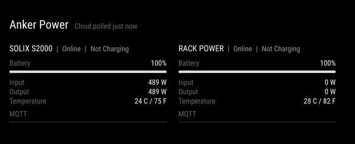

# MMM-AnkerDeviceStatus

**Release: `1.0.0`.**

Automated tests and the live mirror layout have been verified.
Live authentication/discovery and battery, temperature, and charging-state
telemetry on A1761 (C1000) and AS220 (S2000) were verified on October 9, 2026.
Other readings, devices, firmware combinations, and long-term reliability
remain unverified. Remaining runtime is covered by automated tests but has not
yet been verified during live battery discharge. Device support below reflects
the upstream client's capabilities, not completed end-to-end testing of every model.

Report test results and problems through
[GitHub issues](https://github.com/rroach3753/MMM-AnkerDeviceStatus/issues).
Include the model, firmware, runtime versions, and a sanitized error description.
Never upload credentials, account tokens, authentication caches, or unredacted
device/account data.

A read-only MagicMirror² module for Anker SOLIX systems and supported Wi-Fi
power devices registered in the **Anker app**. Displays device names, connection
status, battery percentage, input/output watts, available solar power, and
optional temperature. Includes device filtering, custom names, compact layout,
low-battery highlighting, and explicit unavailable/stale-data messages.

Open [examples/preview.html](examples/preview.html) in a browser for a sample
layout without credentials. All values in that preview are fictional.

The display defaults to **SOLIX devices only**. Prime chargers, charging bases,
power banks and unclassified devices are hidden, regardless of their custom
names. Set `solixOnly: false` to include the wider Anker device list.

Device cards use two equal-width columns and as many rows as needed. The heading,
warnings, and cloud-poll timestamp span both columns. The module is 660px wide,
limited by the viewport width; long device names wrap within their column.
Each card header shows the device name, connection status, and available charging
status together, wrapping when needed. Model numbers are not displayed.

## Compatibility

Uses the unofficial [anker-solix-api](https://github.com/thomluther/anker-solix-api)
client, pinned to a source revision verified by automated tests and the live models noted above. Anker can change its cloud services
without notice; this is not an official Anker integration.

- SOLIX Solarbank, supported portable power stations, power panels and X1 systems.
- Supported Anker smart plugs, smart meters and Wi-Fi chargers, including the
  A2345 Prime 250W charger and A91B2 charging station.
- Actual support and available measurements depend on the client library,
  model, firmware, account permissions and whether the device reports to the
  cloud. See the upstream [supported device list](https://github.com/thomluther/anker-solix-api#supported-devices).
- Wi-Fi alone is **not** sufficient: unrelated brands, Eufy/Soundcore devices,
  and Bluetooth-only chargers/power banks are not supported.

Many standalone devices provide almost no telemetry through the HTTP API.
This module subscribes to MQTT telemetry using Anker-issued credentials.
For A1761, AS220, A2345 and A91B2 it also requests status every 60 seconds and
activates real-time telemetry for 300 seconds, renewed every 240 seconds where
the upstream model supports it. These requests do not change outputs or charging
settings, but can increase network traffic and device power use. Other models
remain passive. Some models only publish useful readings while awake; readings
may remain unavailable.
An account listing does not prove a device is online.

## Requirements

- MagicMirror² with Node.js 20.12 or newer (`node --run` is used for project scripts).
- Python 3.12 or newer (upstream currently supports 3.12–3.14), pip and Git.
- Internet access to Anker's HTTPS API and MQTT service.
- An Anker email/password account and its correct two-letter country code.
  Use the owner account for the most complete device discovery.

## Installation

### Install with MMPM (MagicMirror Package Manager)

Install the module and move into its directory:

```sh
mmpm install MMM-AnkerDeviceStatus
cd ~/MagicMirror/modules/MMM-AnkerDeviceStatus
```

MMPM installs the module files; it does not install the Python runtime or the
Python packages this module needs. Create the module's virtual environment
using Python 3.12–3.14. For example, if Python 3.13 is installed:

```sh
python3.13 -m venv .venv
.venv/bin/python -m pip install -r requirements.txt
```

If the host only has an older Python (for example, Python 3.11), install
[uv](https://docs.astral.sh/uv/getting-started/installation/), then install a
supported Python and use it to create the environment:

```sh
uv python install 3.13
uv venv --python 3.13 .venv
uv pip install --python .venv/bin/python -r requirements.txt
```

### Create or recreate the Python virtual environment

Use these steps after installing with MMPM if `.venv` is missing, or to rebuild
it if its Python packages are damaged or out of date. Run them on the
MagicMirror host from the module directory. Stop MagicMirror first so its Anker
helper is not using the environment:

```sh
cd ~/MagicMirror/modules/MMM-AnkerDeviceStatus
```

With Python 3.12–3.14 installed, create or clear the module's virtual
environment, then install all declared dependencies. Substitute the
appropriate interpreter command if needed (for example, `python3.12`):

```sh
python3.13 -m venv --clear .venv
.venv/bin/python -m pip install --upgrade pip
.venv/bin/python -m pip install -r requirements.txt
```

If the system Python is too old, use `uv` to install Python 3.13 and recreate
the environment instead:

```sh
uv python install 3.13
uv venv --clear --python 3.13 .venv
uv pip install --python .venv/bin/python -r requirements.txt
```

On Windows, use `py -3.13 -m venv --clear .venv` to create or recreate the
environment, then install dependencies with
`.venv\Scripts\python.exe -m pip install -r requirements.txt`.

Recreating `.venv` does not change `.env` or MagicMirror's `config.js`; keep
both files. It does replace the installed Python packages and their local
authentication cache, so the module may need to authenticate with Anker again.
Start MagicMirror after installation completes.

Set Anker credentials either in the MagicMirror launch environment or in the
module's `.env` file. To create the file from the provided template:

```sh
cp .env.example .env
chmod 600 .env
```

Edit `.env` with your Anker email, password, and country code as described
below. Keep it private; never add credentials to `config.js`. Add or retain the
module's configuration entry in MagicMirror's `config.js`, then restart
MagicMirror. See the [configuration example](#magicmirror-configuration-example).

### Install manually with Git

On the **machine running MagicMirror**, clone the module into your
MagicMirror modules directory:

```sh
cd ~/MagicMirror/modules
git clone https://github.com/rroach3753/MMM-AnkerDeviceStatus.git
cd MMM-AnkerDeviceStatus
```

Adjust the MagicMirror path if your installation is elsewhere. Then install:

```sh
python3 -m venv .venv
.venv/bin/python -m pip install -r requirements.txt
cp .env.example .env
chmod 600 .env
```

On Windows, use `.venv\Scripts\python.exe` instead of `.venv/bin/python`.
Edit `.env` locally:

```dotenv
ANKER_EMAIL=you@example.com
ANKER_PASSWORD="your-password"
ANKER_COUNTRY=US
```

Quote passwords containing `#`, spaces or other dotenv-special characters.
Do not paste credentials into MagicMirror's browser-visible configuration.
The Python helper loads `.env` from this module directory. Existing environment
variables take precedence. Protect the module's `.venv` directory too: the
upstream library caches account tokens inside its package's `authcache` folder.
The helper creates new files with owner-only permissions.

The Node helper uses the module's `.venv` by default. To use a different
interpreter, set `ANKER_PYTHON` to its absolute path in the **environment that
launches MagicMirror** (not in `.env`, which is loaded after Python starts).
For example, configure your service/PM2 environment and restart MagicMirror.

## Configuration

### MagicMirror configuration example

Add the module entry to the existing `modules` array in
`~/MagicMirror/config/config.js`. Keep your other module entries; the example
below shows only this module. Anker credentials belong in `.env` or the
MagicMirror launch environment, not in `config.js`.

```js
modules: [
  {
    module: "MMM-AnkerDeviceStatus",
    position: "top_right",
    config: {
      title: "Anker Power",
      showOffline: true,
      showBattery: true,
      showPower: true,
      compact: false
    }
  }
],
```

Restart MagicMirror after changing credentials or polling settings.

## Updating

From the module directory, fetch the latest version and refresh the Python
dependencies:

```sh
git pull --ff-only
.venv/bin/python -m pip install -r requirements.txt
node --run check
node --run test
node --run lint
```

Create the `.venv` first if it does not exist. Keep your `.env` file; updating
the source does not require replacing it. Restart MagicMirror after updating.
On Windows, use `.venv\Scripts\python.exe` for the Python command.

## Display configuration

| Option | Default | Description |
| --- | --- | --- |
| `title` | `"Anker Power"` | Heading; empty string hides it |
| `showOffline` | `true` | Include explicitly offline devices; unknown devices are retained |
| `showCloudOnly` | `true` | Set to `false` to hide Cloud only cards; waiting/stale MQTT cards remain visible |
| `solixOnly` | `true` | Show SOLIX power stations, energy systems and associated device families (including AS200 alternator charger); hide Prime chargers, power banks and unknown families |
| `deviceIds` | `[]` | Serial-number allowlist; empty shows all account devices |
| `deviceNames` | `{}` | Name overrides keyed by device serial number |
| `showBattery` | `true` | Battery reading/bar for battery-equipped devices |
| `showPower` | `true` | Input/output and available solar watts |
| `showTemperature` | `false` | Temperature in Celsius and Fahrenheit when provided by MQTT |
| `showCharging` | `true` | Charging/not-charging state for C1000 (A1761) and S2000 (AS220); unknown is explicit |
| `showRuntime` | `true` | Device-reported remaining hours/minutes while discharging; hidden when idle/charging, `--` if unknown |
| `showUpdated` | `true` | Age of the last successful HTTP cloud poll beside the module title |
| `compact` | `false` | Smaller cards |

Example: `deviceNames: { "YOUR_DEVICE_SERIAL": "Office backup" }`.
Find serial numbers in the Anker app/device label. Names are rendered as text,
not HTML. Multiple module instances share one account connection.

## Server configuration

Set these in `.env` or MagicMirror's process environment:

| Variable | Default | Description |
| --- | --- | --- |
| `ANKER_EMAIL` | Required | Anker account email |
| `ANKER_PASSWORD` | Required | Anker account password |
| `ANKER_COUNTRY` | Required | Two-letter account country code, such as `US` or `DE` |
| `ANKER_POLL_INTERVAL` | `300` | HTTP polling seconds, minimum 60 |
| `ANKER_DETAILS_INTERVAL` | `1800` | Device discovery/detail polling seconds, at least the HTTP interval |
| `ANKER_MQTT` | `true` | Enable MQTT and supported read-only telemetry requests; `true` or `false` |
| `ANKER_MQTT_STALE_SECONDS` | `600` | Stop using MQTT readings after this many seconds without a decoded device update |
| `ANKER_PYTHON` | Module's `.venv` | Interpreter path; **process environment only** |

MQTT-backed cards refresh about every 15 seconds; that does not increase HTTP
polling. Cloud data is often already delayed by Anker. A fetched timestamp
indicates a successful cloud poll, **not** a fresh measurement from every device.
Individual MQTT fields expire independently: unrelated packets do not refresh
old battery, temperature or charging readings. Charging uses the model-specific
reported state, not a guess from wattage. Expired/disconnected MQTT readings fall back to available HTTP values, otherwise
show `--`. A partial AC/DC reading is not shown as total input/output. Zero watts
and zero battery are preserved. During an HTTP failure the last successful
cards remain visible with an error and their cloud-poll age.

Runtime is Anker's `remaining_time_hours` estimate, not a capacity calculation.
S2000 discharge is determined from its reported battery state. C1000 discharge
requires inactive charging and fresh, complete MQTT output exceeding input.
Missing or stale discharge/runtime fields show `--`; idle or charging devices
hide the runtime row. Runtime accuracy depends on the device and current load.

## Troubleshooting

- **Cannot start helper:** Create `.venv` on the mirror host and install the
  requirements, or set `ANKER_PYTHON` in the launch environment.
- **Missing dependencies:** Run the pip installation again in the interpreter
  actually used by the helper. The requirements explicitly include runtime
  dependencies missing from the upstream wheel metadata.
- **Cloud poll failed:** Check account password/country, internet connection and
  Anker service availability. Errors intentionally omit raw API responses and
  credentials. Cloud polls retry at the configured interval; helper crashes
  retry after 60 seconds.
- **Waiting for MQTT / MQTT stale:** The device has not supplied a recent
  decoded MQTT update. Confirm Wi-Fi connectivity and model support; wake the
  device or open its app to see whether it starts publishing.
- **No devices:** Verify devices appear in the Anker app for this account.
  Shared accounts have limited device-detail permissions.
- **macOS certificate failures:** Install the root certificates supplied with
  your Python installation. Do not disable TLS verification.

## Validation

JavaScript tests use Node's built-in test runner. ESLint is a development
dependency; Python runtime dependencies are declared in `requirements.txt`.
Running ESLint 10 requires Node.js 20.19 or newer; the module itself supports
Node.js 20.12 and newer.

```sh
node --run check
node --run test
node --run lint
.venv/bin/python -m unittest discover -s tests -p 'test_*.py'
```

Tests cover normalization, missing/zero/stale values, polling/MQTT setup,
rendering, filtering, instance isolation, shared workers and failure recovery.
Real account/device compatibility must be checked with your own account.

## Screenshots


